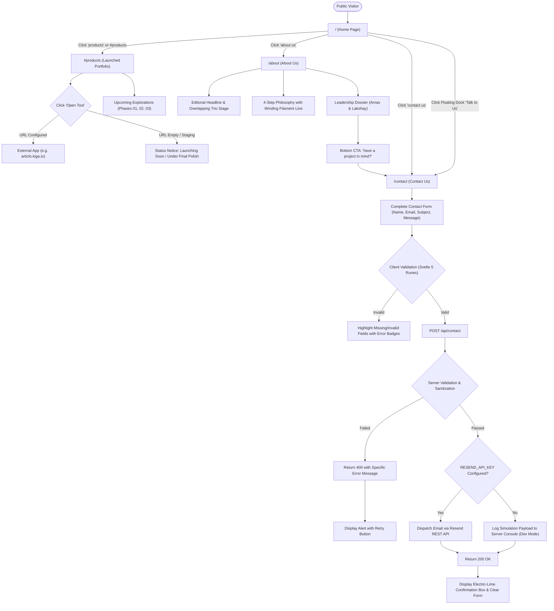

# 🌐 Kiga (`kiga*`) — Complete Project Context & User Flow Specification

> **Document Version**: 1.0.0  
> **Repository**: `kiga websitee`  
> **Status**: Production-Ready / Active Local Server (`http://localhost:5173`)  
> **Design Language**: "August" Editorial Style (Sage Green Framed Canvas, Matte Black, Electric Lime, Lowercase Typography)

---

## 1. Executive Summary & Brand Identity

### 1.1 Brand Purpose
**Kiga** (`kiga*`) is a digital product collective and studio that engineers focused, single-purpose digital utilities and software. Rather than building bloated, monolithic platforms, Kiga crafts distinct tools that address specific bottlenecks for targeted audiences with speed, precision, and restrained design craft.

### 1.2 Brand Ethos & Positioning
- **Name**: `kiga*` (Stylized with trailing asterisk in lowercase)
- **Tagline**: *"Small Solutions. Meaningful Impact."*
- **Manifesto**: *"We are a digital product collective building focused tools, dedicated software, and purposeful utilities. No monolithic bloat—just purpose-built software."*
- **Headquarters**: New Delhi, India & Global Remote (Operating asynchronously worldwide).
- **Leadership**:
  - **Arnav Nahata**: Co-Founder & Product Lead (Product discovery, UX architecture, interaction design).
  - **Lakshay Jain**: Co-Founder & Engineering Lead (System architecture, full-stack engineering, infrastructure).

---

## 2. Technical Stack & Architecture

### 2.1 Core Framework & Tooling
| Component | Technology | Description |
| :--- | :--- | :--- |
| **Framework** | **SvelteKit 3** (`@sveltejs/kit` ^3.0.0) | High-performance full-stack web framework |
| **Reactive Engine** | **Svelte 5** (`svelte` ^5.57.1) | Modern Svelte 5 Runes API (`$state`, `$derived`, `$props`) |
| **Bundler & Dev Server**| **Vite 8** (`vite` ^8.3.0) | Instant HMR, lightning-fast SSR compilation |
| **Adapter** | `@sveltejs/adapter-auto` ^8.0.0 | Zero-config automatic deployment to Vercel, Node, or Cloudflare |
| **Styling** | **Pure Vanilla CSS + Scoped Styles** | Centralized design tokens in `src/app.css` |
| **API & Serverless** | SvelteKit Server Endpoints (`+server.js`) | Native Edge/Node HTTP handlers |
| **Transactional Email**| **Resend REST API** (`https://api.resend.com/emails`) | Secure email notification dispatch with dev simulation fallback |

### 2.2 Local Hosting Commands
```bash
# 1. Install project dependencies
npm install

# 2. Launch Vite development server
npm run dev
# Running at: http://localhost:5173/

# 3. Production Build & Preview
npm run build
npm run preview
```

---

## 3. Design System & Editorial Aesthetics ("August" Reference)

The visual design system is an exact recreation of the premium **"August"** editorial aesthetic:

```
┌────────────────────────────────────────────────────────────────────────┐
│  SAGE GREEN OUTER BORDER FRAME (--sage-border: #608259, 22px width)     │
│  ┌──────────────────────────────────────────────────────────────────┐  │
│  │  DEEP MATTE BLACK CANVAS (--bg-canvas: #050605)                  │  │
│  │                                                                  │  │
│  │  kiga*             about us    products    philosophy   [talk]   │  │
│  │  ══════════════════════════════════════════════════════════════  │  │
│  │                                                                  │  │
│  │  [main / digital products]                                       │  │
│  │                                  [ Overlapping Photo Stage ]     │  │
│  │                                  [ BW Portrait / Emerald / Purple]│  │
│  │  kiga*                                                           │  │
│  │                                                                  │  │
│  │  + Based in New Delhi & Remote, operating worldwide              │  │
│  │  |                                                               │  │
│  │  we are a digital product collective...                          │  │
│  │  [explore products]   [about us ->]                              │  │
│  │                                                                  │  │
│  └──────────────────────────────────────────────────────────────────┘  │
└────────────────────────────────────────────────────────────────────────┘
```

### 3.1 Design Tokens (`src/app.css`)
- **Outer Frame**: `--sage-border: #608259`, `--sage-border-dark: #4F6D49` (Responsive width: 22px desktop, 14px tablet, 8px mobile).
- **Backgrounds**: `--bg-canvas: #050605` (Deep matte black), `--bg-surface: #0C0E0C`, `--bg-surface-elevated: #141714`, `--bg-input: #111311`.
- **Accents**: `--accent-lime: #D8F55C` (Electric yellow-lime), `--accent-lime-hover: #E4FE74`, `--accent-lime-glow: rgba(216, 245, 92, 0.3)`.
- **Typography Colors**: `--text-white: #FFFFFF`, `--text-offwhite: #E6E8E5`, `--text-muted: #8E928C`, `--text-dark-muted: #565A54`.
- **Fonts**:
  - Primary: `'Plus Jakarta Sans'`, `-apple-system`, `sans-serif`.
  - Editorial Accents: `'Times New Roman'`, serif italic.
- **Graphic Elements**:
  - Continuous winding neon-lime filament line through the 4-step process section.
  - Floating overlapping 3-photo stage with subtle rotation angles (`-4deg`, `0deg`, `5deg`).
  - Pulsing ambient dock pill with live local clock.

---

## 4. File Inventory & Repository Structure

```
d:/kiga websitee/
├── .env.example                     # Environment template (RESEND_API_KEY, emails)
├── package.json                     # Scripts & Svelte 5 / Vite 8 dependencies
├── vite.config.js                   # SvelteKit Vite plugin config with runes mode enabled
├── static/
│   ├── favicon.svg                  # Brand vector mark
│   ├── robots.txt                   # Search engine crawl rules
│   ├── sitemap.xml                  # XML sitemap (/ , /about, /contact)
│   └── images/                      # Curated high-res editorial imagery
│       ├── thumb-portrait-bw.jpg    # Editorial B&W portrait
│       ├── thumb-green-tunnel.jpg   # Emerald architectural corridor
│       ├── thumb-purple-stage.jpg   # Purple luminescent stage
│       ├── articlo-preview.jpg      # Articlo product mockup
│       └── bazinga-preview.jpg      # Bazinga product mockup
└── src/
    ├── app.html                     # HTML root shell & Google Fonts loader
    ├── app.css                      # Global design tokens, August border frame, reset
    ├── lib/
    │   ├── index.js                 # Library export barrel
    │   ├── data/
    │   │   ├── siteConfig.js        # Global site metadata, URLs, navigation routes
    │   │   ├── products.js          # Products data (Articlo, Bazinga) & future explorations
    │   │   └── team.js              # Founders profiles, bios, roles, quotes
    │   └── components/
    │       ├── Navbar.svelte        # Header bar, logo, links, mobile slide drawer
    │       ├── Footer.svelte        # Editorial footer, sitemap links, social handles
    │       ├── ProductDeck.svelte   # Grid presentation of active portfolio tools
    │       ├── TeamCard.svelte      # Individual founder card with bio and quote
    │       ├── ContactForm.svelte   # Interactive inquiry form with validation & states
    │       └── FloatingBottomDock.svelte # Live dock with pulsing signal & time
    └── routes/
        ├── +layout.svelte           # Root layout mounting August frame, Navbar & Footer
        ├── +page.svelte             # Home page (Hero, Products, Explorations, CTA)
        ├── about/
        │   └── +page.svelte         # About page (Trio Stage, Philosophy, 4-Step Process, Team)
        ├── contact/
        │   └── +page.svelte         # Contact page (Coordinates, Inquiry categories, Form)
        └── api/
            └── contact/
                └── +server.js       # SvelteKit serverless POST endpoint (Resend email dispatch)
```

---

## 5. Data Models & Configuration Specifications

### 5.1 Products Schema (`src/lib/data/products.js`)
```javascript
{
  id: 'articlo',                          // Unique slug
  name: 'Articlo',                        // Product display title
  tagline: 'Focused Digital Utility',      // Subtitle
  category: 'Digital Publishing & Content',// Domain
  status: 'Launched',                     // 'Launched' | 'In Development' | 'Beta'
  badge: 'Active Product',                // Visual status pill
  url: '',                                // Target URL (empty displays graceful in-progress state)
  description: '...',                     // Full description
  problem: '...',                         // Specific pain point addressed
  audience: 'Writers, creators, teams',   // Primary users
  accentColor: '#FF4724',                 // Brand highlight color
  bgGradient: 'linear-gradient(...)',     // Card background gradient
  features: ['...', '...'],               // 3 core utility pillars
  featured: true
}
```

### 5.2 Team Schema (`src/lib/data/team.js`)
```javascript
{
  id: 'arnav-nahata',
  name: 'Arnav Nahata',
  role: 'Co-Founder & Product Lead',
  initials: 'AN',
  avatarColor: '#FF4724',
  bio: '...',
  quote: 'We believe digital software should do one job with unmatched clarity...',
  social: { twitter: '', linkedin: '', github: '', email: '' }
}
```

### 5.3 Contact API Contract (`src/routes/api/contact/+server.js`)
- **HTTP Method**: `POST`
- **Request Body**:
  ```json
  {
    "name": "Alex Mercer",
    "email": "alex@example.com",
    "phone": "+1 555-0199",
    "subject": "Collaboration Inquiry",
    "message": "Interested in building a tool with the collective...",
    "product": "General",
    "inquiryType": "Partnership / Collaboration"
  }
  ```
- **Validation Constraints**:
  - `name`: Required, max 120 chars.
  - `email`: Required, valid RFC-5322 regex format, max 150 chars.
  - `subject`: Required, max 200 chars.
  - `message`: Required, max 4000 chars.
- **Success Response (200 OK)**:
  ```json
  {
    "success": true,
    "message": "Your message has been sent successfully. We'll be in touch soon!"
  }
  ```
- **Error Response (400 Bad Request / 500 Server Error)**:
  ```json
  {
    "success": false,
    "error": "A valid email address is required."
  }
  ```

---

## 6. Complete End-to-End User Flows

### 6.1 Complete Global Architecture & Navigation User Flow (Mermaid)



---

### 6.2 Detailed Persona User Journeys

#### Persona 1: The Product Explorer (Evaluating Kiga's Tools)
1. **Entry**: Lands on `https://kiga.io/` (or `http://localhost:5173/`).
2. **Visual Hook**: Sees the signature August outer sage frame, giant `kiga*` typography, and floating overlapping art photographs.
3. **Trigger**: Clicks **`explore products`** pill button or scrolls to `#products`.
4. **Analysis**:
   - Inspects **Articlo** card: Reads problem (*"Digital publishing workflows are over-engineered"*), audience (*"Writers & creators"*), and key 3-point feature checklist.
   - Inspects **Bazinga** card: Reads problem (*"Monolithic software impedes niche execution"*), and reviews feature set.
5. **Action**:
   - Clicks product CTA. If domain is configured, opens in a new tab; if pending launch, receives an inline notice indicating deployment status.
6. **Next Step**: Scrolls down to inspect the 3 upcoming research phases (`Creator Workflow Automation`, `Niche Analytics Micro-Tool`, `Community Utility Platform`) to understand future roadmap.

#### Persona 2: The Potential Client / Founder Collaborator (Reaching Out)
1. **Discovery**: Navigates to `/about` to evaluate who is behind Kiga.
2. **Evaluation**:
   - Reads the 4-step philosophy:
     - `01 / understand`: Isolate root friction.
     - `02 / strip away`: Remove 80% non-essential fluff.
     - `03 / build focused`: High-speed, focused engineering.
     - `04 / ship & iterate`: Real user validation.
   - Reviews team credentials for **Arnav Nahata** (Product) and **Lakshay Jain** (Engineering).
3. **Transition**: Clicks `/contact` from the navbar, bottom banner, or floating dock.
4. **Form Submission Journey**:
   - Chooses inquiry type: *"General inquiry"*, *"Product feedback"*, or *"Collaboration"*.
   - Fills out: Name, Work Email, Subject, and detailed message.
   - Hits **"send inquiry"**.
   - UI instantly displays an electric-lime loading indicator with disabled fields to prevent double-submissions.
   - Receives instant confirmation: *"message sent! we'll respond within 24 hours."*

#### Persona 3: Mobile Visitor
1. **Viewport Adaptation**: Outer sage frame reduces from 22px to 8px; font scales down smoothly while preserving editorial hierarchy.
2. **Navigation**: Taps the custom hamburger icon in top-right.
3. **Drawer**: Full-screen matte-black menu animates into view with smooth vertical links (`about us`, `products`, `philosophy`, `team`, `contact us`).
4. **Dock Interaction**: Bottom floating dock collapses non-essential text, retaining the active pulse indicator and **"Talk to Us"** shortcut.

---

## 7. Configuration Guide & Environment Deployment

### 7.1 Environment Variables Setup (`.env`)
To enable real email dispatch for the contact form, create a `.env` file in the root directory:

```ini
# Resend API Key (Obtain from https://resend.com)
RESEND_API_KEY=re_123456789abcdef

# Target business email where contact form submissions land
CONTACT_TO_EMAIL=hello@kiga.io

# Sender email (Use 'onboarding@resend.dev' for testing, or your verified domain sender)
CONTACT_FROM_EMAIL=contact@kiga.io
```

### 7.2 Deployment Checklist (Vercel / Cloudflare)
1. Push repository to GitHub/GitLab.
2. Connect repository to Vercel.
3. Configure `RESEND_API_KEY`, `CONTACT_TO_EMAIL`, and `CONTACT_FROM_EMAIL` in Vercel **Project Settings > Environment Variables**.
4. Verify custom domain in Resend and update DNS SPF/DKIM records.
5. Deploy — `@sveltejs/adapter-auto` automatically provisions serverless endpoints.
